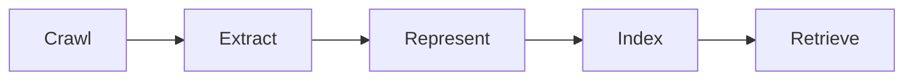

# hunterthe.dev

Personal site and blog, built with [Astro](https://astro.build). Pushing to `master` builds the site and deploys
`dist/` to the `gh-pages` branch.

## Run locally

```sh
npm install
npm run dev      # http://localhost:4321, drafts included
npm run build    # production build into dist/, drafts excluded
npm run preview  # serve dist/
npm run check    # type-check
```

Profile text (summary, about, experience, education, contact) lives in `src/data/profile.ts`. The hero graph's
tuning constants are at the top of `src/lib/graph.ts` (layout) and `src/components/KnowledgeGraph.astro` (motion).

## Write a post

Each post is a folder, served at `/blog/<slug>/`, with its images beside the Markdown:

```text
src/content/blog/<slug>/
  index.md
  diagram.png
```

Start `index.md` with this frontmatter:

```yaml
---
title: Post title
description: One or two sentences, used on the blog index and in link previews.
pubDate: 2026-11-22
# updatedDate: 2026-12-01
tags: [notes]
# Drafts appear in `npm run dev` but are left out of the build and sitemap.
draft: true
---
```

Set `draft: false` (or delete the line) to publish. Reference images relatively, and Astro resizes them, converts
them to modern formats and sets their dimensions. An emphasised line right after an image becomes its caption:

```markdown

_How the storage layer lays out columns._
```

Code blocks are highlighted for light and dark themes automatically.

### Markdown or MDX

Use `index.md` for plain Markdown. Use `index.mdx` when a post needs components; the frontmatter, images and URL
work the same way. Components live in `src/components` and are imported relative to the post:

```mdx
import Chart from "../../../components/Chart.astro";

<Chart />
```

### Diagrams

A `mermaid` code block, in `.md` or `.mdx`, becomes an inline SVG at build time that follows the site's fonts and
light/dark colours, with no JavaScript for readers:

````markdown

````

Rendering uses the installed Google Chrome, both locally and on the GitHub runner.
